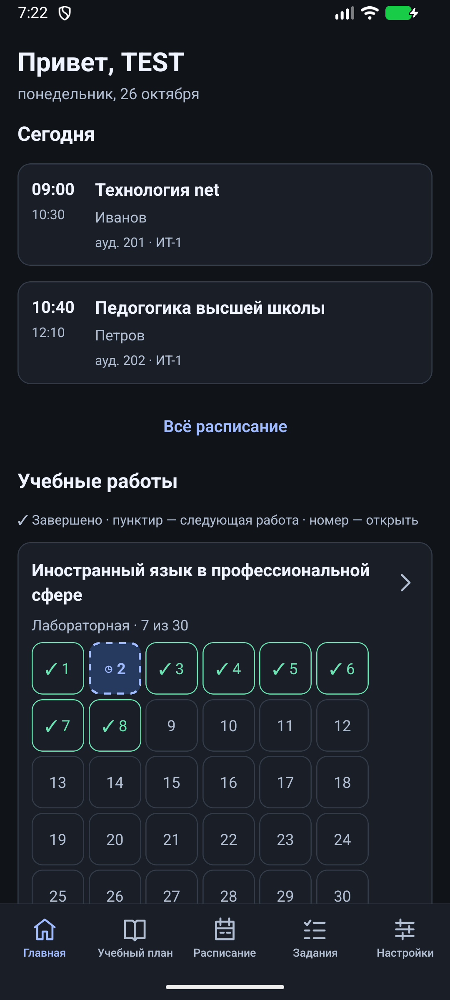
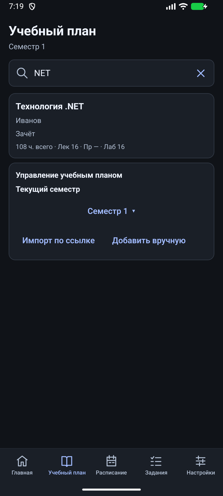
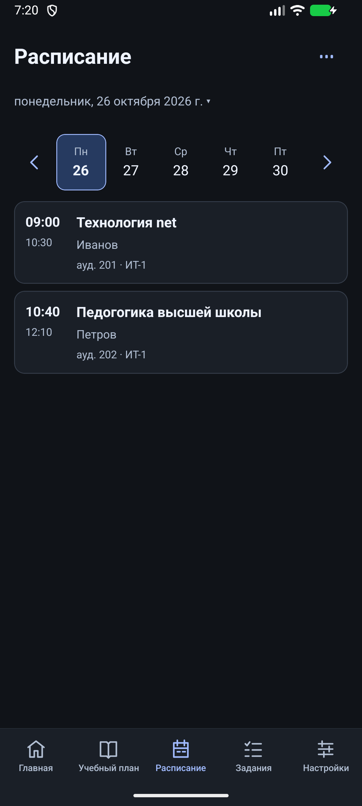
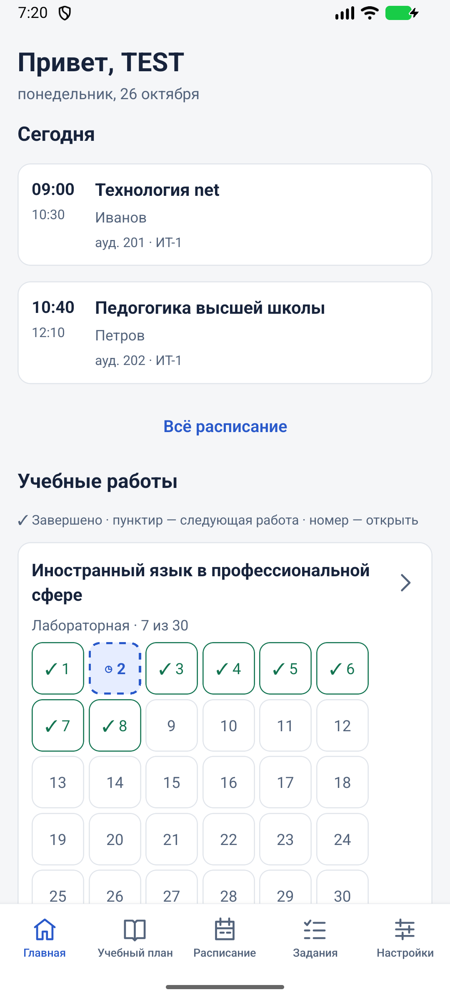

<p align="center">
  
</p>

<h1 align="center">StudyTrack</h1>
<p align="center"><strong>Вся учёба — в одном месте.</strong><br />Учебный план, пары и задания в удобном приложении для Android.</p>

<p align="center">
  
  
  
  
</p>

<p align="center"><a href="#интерфейс">Интерфейс</a> · <a href="#возможности">Возможности</a> · <a href="#запуск">Запуск</a> · <a href="#проверки">Проверки</a></p>

## Интерфейс

<table>
  <tr>
    <td align="center"><strong>Главная</strong></td>
    <td align="center"><strong>Учебный план</strong></td>
    <td align="center"><strong>Расписание</strong></td>
  </tr>
  <tr>
    <td></td>
    <td></td>
    <td></td>
  </tr>
</table>

Скриншоты сняты на Android-эмуляторе с тестовым профилем TEST и демонстрационными занятиями. Сохранённые данные пользователя в репозиторий не входят.

<details>
<summary>Светлая тема</summary>
<p align="center"></p>
</details>

## Возможности

| Раздел | Что внутри |
| --- | --- |
| **Главная** | Сегодняшние пары, прогресс по дисциплинам и следующая незавершённая работа |
| **Учебный план** | Дисциплины по семестрам, часы, формы контроля, поиск и импорт по ссылке |
| **Расписание** | Недельная сетка, календарь, аудитории и преподаватели; импорт из XLSX |
| **Задания** | Лабораторные, практические, курсовые и другие работы; сроки, оценки, заметки и история статусов |
| **Настройки** | Ручной профиль, светлая и тёмная темы, локальные напоминания и резервные копии |

- **Офлайн каждый день.** Журнал хранится локально в SQLite. Подключение нужно для загрузки учебного плана по ссылке.
- **Импорт с просмотром.** Перед сохранением можно проверить дисциплины, выбрать семестр и исправить строки расписания.
- **Прогресс по порядку.** Завершённые, сданные и принятые работы учитываются в прогрессе; следующая работа выделяется на главной.
- **Контроль данных.** Повторный импорт сохраняет пользовательские заметки и оценки. Изменённые работы защищены от автоматического удаления при уменьшении количества.
- **Резервное копирование.** Экспорт и восстановление JSON, выгрузка CSV, локальные напоминания по желанию.

## Запуск

Понадобятся **Node.js 24+** и npm.

```sh
git clone https://github.com/Cinnapik/StudyTrack.git
cd StudyTrack
npm ci
npm start
```

Для локальной Android-сборки установите **JDK 17** и **Android SDK**, настройте `JAVA_HOME` и `ANDROID_HOME`, подключите устройство или запустите эмулятор:

```sh
cd apps/mobile
npx expo run:android
```

Для release-варианта используйте `npx expo run:android --variant release`. Нативный проект создаётся средствами Expo из конфигурации приложения. Android Studio можно использовать для установки SDK и управления эмулятором.

## Первые шаги

1. Откройте **Учебный план**: добавьте дисциплину вручную или импортируйте публичный учебный план по ссылке.
2. Выберите текущий семестр и задайте количество работ по дисциплинам.
3. В **Расписании** добавьте занятия вручную или загрузите XLSX.
4. Отмечайте выполнение работ и при необходимости задавайте сроки, оценки и заметки.
5. В **Настройках** выберите тему, заполните профиль и включите напоминания.

### Импорт расписания

Используется лист **«Расписание»** и именованные заголовки столбцов. Импорт создаёт недельный шаблон по дню недели и времени; колонка даты не используется для определения дня занятия. Перед сохранением приложение показывает строки для проверки и предлагает объединение или замену расписания.

## Проверки

Из корня проекта:

```sh
npm run check
npm run export:android
```

Проверка конфигурации Expo:

```sh
cd apps/mobile
npx expo-doctor
```

`check` запускает TypeScript, ESLint и тесты правил прогресса, миграций, импорта, резервных копий и напоминаний. Android JS export проверяет создание бандла; для проверки нативной сборки используйте Android-устройство или эмулятор.

## Технологии

**React Native 0.88 · Expo SDK 58 · Expo Router · TypeScript · SQLite · Zod**

```text
apps/mobile/src/
  app/           экраны и навигация
  ui/            компоненты и темы
  application/   пользовательские сценарии
  domain/        модели и правила
  persistence/   SQLite и миграции
  integrations/  импорт, файлы и уведомления
packages/contracts/  общие контракты
tests/               автоматические проверки
```
